# Arquitectura de VetCare 24

Arquitectura limpia con **Domain Model (DDD)** — decisión formal en [ADR-001](adr/ADR-001-domain-model-ddd.md).
La regla de dependencia apunta siempre hacia el dominio: `api → application → domain ← infrastructure`.

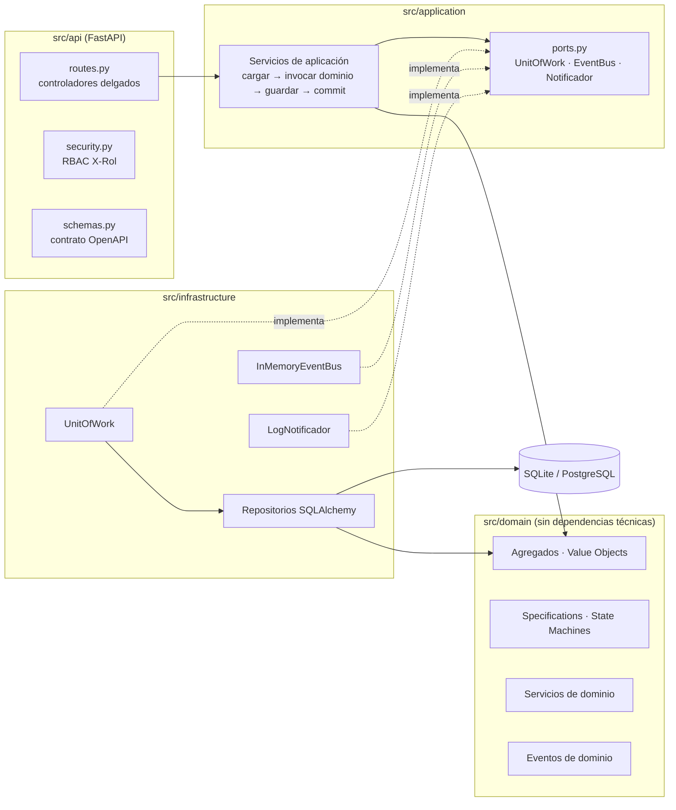

## Agregados (ADR-001 + extensiones)

| Agregado (raíz) | Módulo | Invariantes principales |
|---|---|---|
| `Paciente` (+ `TutorResponsable`, `HojaTriaje`) | `paciente.py` | microchip único; alergias sin duplicar; transferencia conserva historial (RN-05) |
| `Consulta` (+ `NotaSOAP`, `NotaEnmienda`, `ItemReceta`, `EstudioLaboratorio`) | `consulta.py` | nota firmada = congelada (RN-01); urgencia sin trámites (RN-02); resultados de laboratorio se anexan sin editar la nota |
| `Hospitalizacion` (+ bitácora, precuenta) y `Jaula` | `hospitalizacion.py` | lecturas cada 4 h / 2 h crítico; alta cruzada (RN-06) |
| `RegistroVacuna` (+ `ProgramacionRefuerzo`) | `profilaxis.py` | lote y marca obligatorios (RN-03); refuerzo 21/28/365 días |
| `Cita` | `agenda.py` | duración por servicio, sala compatible sin solapes, cancelación tardía < 4 h |
| `OrdenServicio` | `orden_servicio.py` | `puede_procesarse`, beneficio de referencia, máquina de estados (paquete de datos) |
| `Tutor` | `tutor.py` | contacto válido; tutor inactivo no asume responsabilidades |

Los agregados se referencian **solo por id** (`paciente_id`, `tutor_id`): cada transacción modifica un único agregado.

## Diagramas de clases del dominio (UML)

Cada diagrama muestra un agregado con sus entidades internas y Value Objects (rombo lleno = composición dentro del agregado; rombo vacío = opcional).
Todas las raíces `<<aggregate root>>` heredan de `AggregateRoot` (`src/domain/common.py`), que registra los eventos de dominio (`_record`, `pull_events`).
Las flechas punteadas son referencias **por id** entre agregados: ninguno guarda al otro, y cada transacción modifica uno solo.

**1 · Tutor y Paciente**

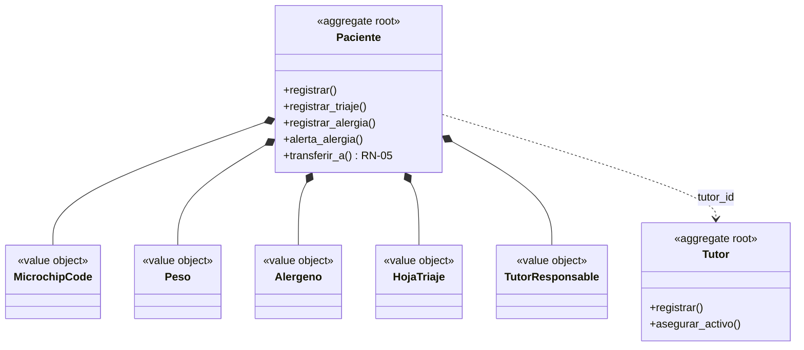

**2 · Consulta (nota SOAP, receta, enmiendas y laboratorio)**

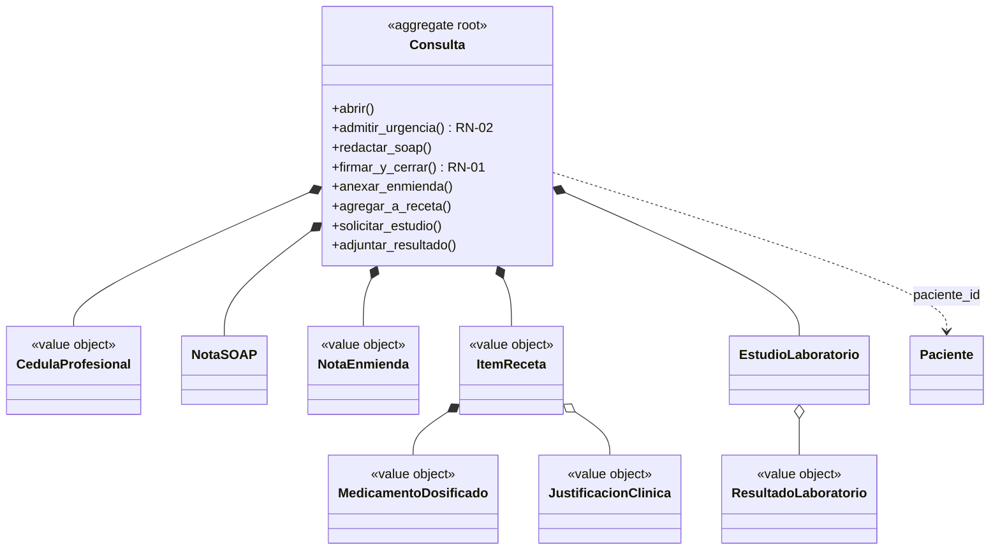

**3 · Hospitalización y Jaula**

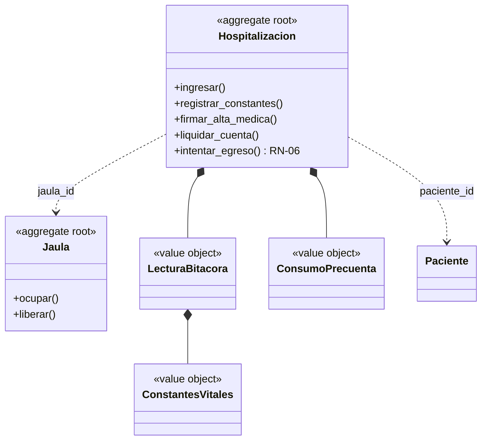

**4 · Vacunas, Citas y Órdenes de servicio**

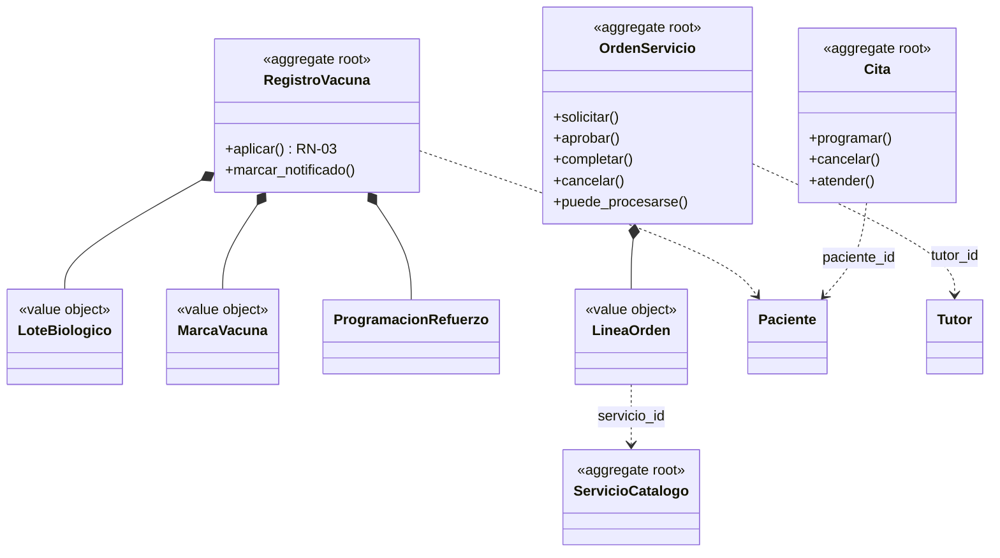

### Specification y State Machine sobre el modelo

**5 · Specification** (cada regla es una clase pequeña; los operadores las combinan)

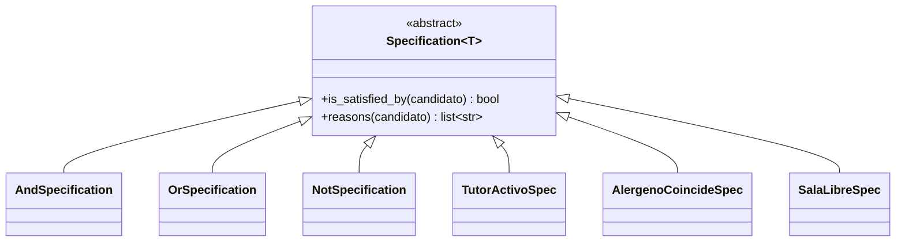

Usos: `OrdenServicio.puede_procesarse` = `TutorActivo & OrdenConLineas & OrdenAutorizada`; `elegible_beneficio_referencia` = `TutorPreferente & TotalMinimo & ~PromocionActiva`;
`Hospitalizacion.es_apto_para_egreso` = `AltaMedicaFirmada & CuentaLiquidada`; `ServicioValidacionAlergias` usa `AlergenoCoincideSpec`; `ServicioAgenda` usa `SalaLibreSpec` e `InicioFuturoSpec`.

**6 · State Machine y servicios de dominio**

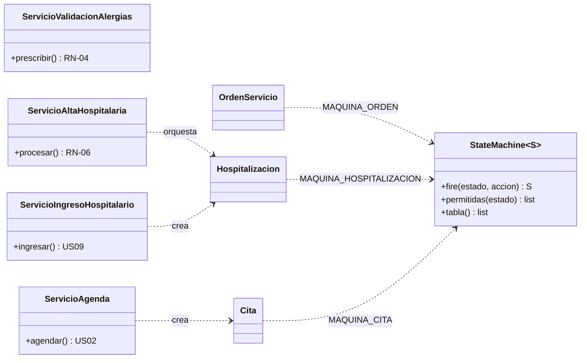

## Patrones exigidos por el PIA

| Patrón | Dónde |
|---|---|
| Domain Model / DDD | `src/domain/*` |
| **Specification** (AND / OR / NOT, con `reasons()`) | `common.py` (`Specification`, `&`, `|`, `~`); catálogo en `specifications.py` y `agenda.py` (`SalaLibreSpec`, `InicioFuturoSpec`) |
| **State Machine** (tabla estado × acción) | `common.py::StateMachine`; `MAQUINA_ORDEN`, `MAQUINA_HOSPITALIZACION`, `MAQUINA_CITA` |
| **Domain Events** (publicados *después* del commit) | `events.py`, `uow.py`, `event_bus.py` |
| Repository + Unit of Work | `repositories.py`, `uow.py` |
| Service Layer delgada | `application/services.py` |

## Principios SOLID

Ver [SOLID.md](SOLID.md): cada principio con código real y la prueba que lo verifica (`tests/unit/test_arquitectura.py` comprueba la regla de dependencia).

## Máquinas de estado

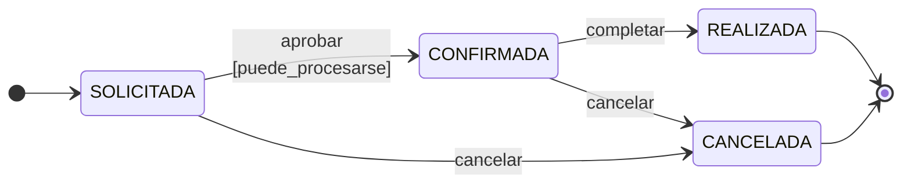

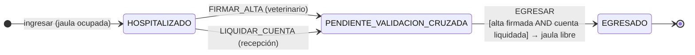

```mermaid
stateDiagram-v2
    direction LR
    [*] --> PROGRAMADA: agendar (sala libre)
    PROGRAMADA --> ATENDIDA: atender
    PROGRAMADA --> CANCELADA: cancelar (libera sala; tardía si < 4 h)
```

## Secuencias clave

**RN-04 — prescripción segura (US06)**

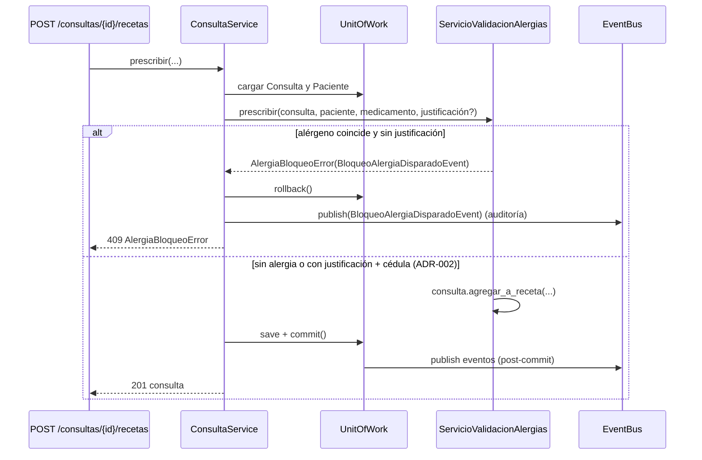

**RN-06 — alta hospitalaria cruzada (US11)**

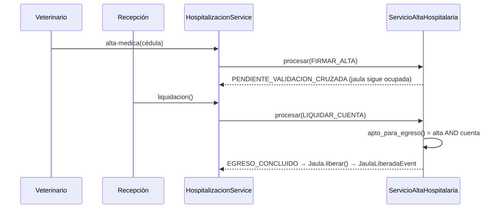

## Modelo de persistencia

Una tabla por agregado: columnas indexadas para consultar (`paciente_id`, `estado`, `inicio`…) + columna `doc`
(JSON en SQLite, **JSONB en PostgreSQL**) con el agregado completo serializado por `codec.py` — [ADR-003](adr/ADR-003-persistencia-documento-json.md).

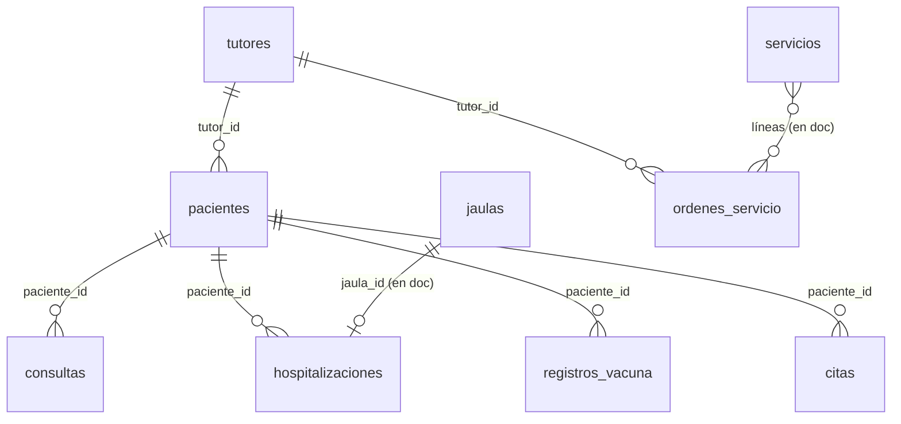

## Despliegue

`Dockerfile` multi-etapa (`base` → `test` / `app`), `docker-compose.yml` (db + app + tests), CI en GitHub Actions
(`.github/workflows/ci.yml`: pruebas con PostgreSQL de servicio, cobertura ≥ 80 %, exportación de OpenAPI, build de imagen y *deploy hook*)
y `render.yaml` (Blueprint: PostgreSQL + servicio web Docker). Configuración 100 % por variables de entorno (`.env.example`).
